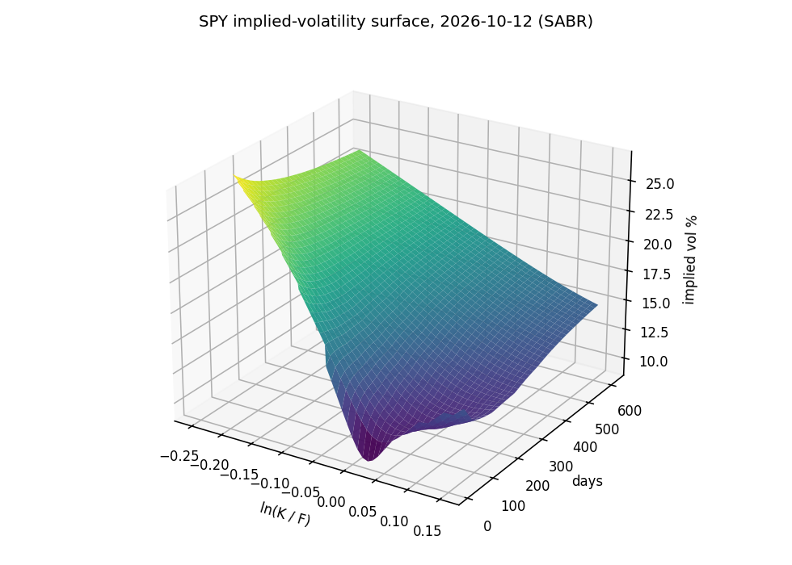
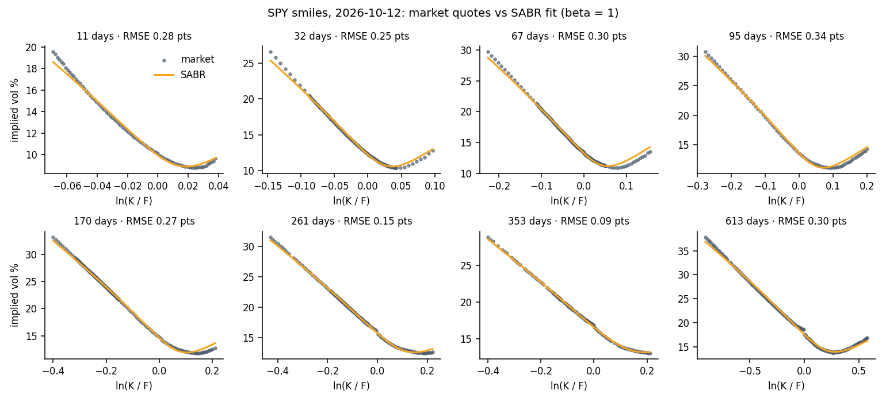
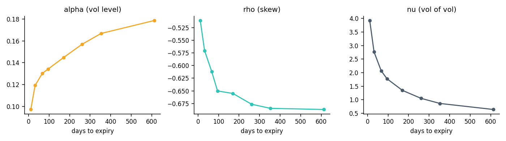

# SABR implied-volatility surface for SPY options

Calibrates the SABR stochastic-volatility model to the live SPY option market, one expiry at
a time, and stitches the slices into a full, arbitrage-checked implied-volatility surface that
prices any strike and maturity with Greeks.

Snapshot used below: **12 Oct 2026**, SPY at **$778.10**, 8 expiries from 11 days to 1.7 years,
1,074 cleaned quotes.



## Results

| Days | Forward | ATM vol | α | ρ | ν | Fit RMSE | Quotes |
| --- | --- | --- | --- | --- | --- | --- | --- |
| 11 | 779.03 | 9.9% | 0.097 | −0.51 | 3.93 | 0.28 pts | 83 |
| 32 | 780.85 | 12.2% | 0.119 | −0.57 | 2.77 | 0.25 pts | 118 |
| 67 | 783.18 | 13.3% | 0.130 | −0.61 | 2.07 | 0.30 pts | 159 |
| 95 | 784.82 | 13.6% | 0.134 | −0.65 | 1.78 | 0.34 pts | 74 |
| 170 | 790.39 | 14.6% | 0.145 | −0.66 | 1.35 | 0.27 pts | 163 |
| 261 | 798.29 | 15.7% | 0.157 | −0.68 | 1.05 | 0.15 pts | 161 |
| 353 | 805.69 | 16.6% | 0.167 | −0.69 | 0.86 | 0.09 pts | 129 |
| 613 | 829.88 | 17.6% | 0.179 | −0.69 | 0.64 | 0.30 pts | 187 |

- **Every smile fits to within 0.1 to 0.35 vol points.**
- **ρ is strongly negative (−0.5 to −0.7):** the equity skew, where downside puts trade rich
  because index volatility rises when markets fall.
- **ν falls from 3.9 to 0.6 with maturity:** short-dated smiles are far more curved, the
  usual decay of vol of vol with tenor.
- **ATM vol rises from 9.9% to 17.6%:** an upward-sloping term structure, typical of a calm market.
- **No arbitrage:** zero calendar violations (total variance rises with maturity) and zero
  butterfly violations (call prices convex in strike) across ±3 standard deviations on every expiry.





## How it works

1. **Market data** (`sabr/data.py`). Pull the SPY chains for 8 target tenors. The discount factor
   comes from the 13-week Treasury bill yield; each expiry's forward comes from put-call parity,
   F = K + (C − P)/D, taken as the **median** over tight near-the-money pairs, which ignores stale
   quotes that throw off a regression. Keep out-of-the-money quotes only, drop zero bids and wide
   spreads, and drop any quote that is priced above a quote further from the money.
2. **Implied vols** (`sabr/black.py`). Black-76 on the forward, inverted with Brent's method
   inside no-arbitrage bounds.
3. **SABR calibration** (`sabr/model.py`). Hagan et al. (2002) closed-form implied vol with β = 1
   (lognormal backbone, standard for equity indices). α, ρ and ν are fitted per expiry by
   least squares in vol space, weighted by Black vega so the far wings, where implied vols from
   tiny prices are noisiest, count for less.
4. **Surface** (`sabr/surface.py`). Forwards interpolate log-linearly from spot. Total variance
   w = σ²T interpolates linearly in maturity at fixed log-moneyness, which preserves the absence
   of calendar arbitrage between calibrated slices.
5. **Quotes.** `Surface.quote(strike, t, kind)` returns forward, vol, price, delta, gamma, vega
   and theta for any European option.

```python
from sabr.data import load_snapshot, clean_quotes
from sabr.surface import build_surface

snap = load_snapshot()
surface, _ = build_surface(clean_quotes(snap), spot=snap["spot"].iloc[0], rate=snap["rate"].iloc[0])
surface.quote(700, 0.5, "put")
# {'forward': 791.47, 'vol': 0.204, 'price': 11.53, 'delta': -0.174, 'gamma': 0.0022, 'vega': 142.9, 'theta': -29.2}
```

## Testing

19 tests (`pytest -q`):
- Black-76 against a reference price, put-call parity, implied-vol round trips, vega vs a finite difference
- Hagan's formula against a **Monte Carlo simulation of the SABR process** (independent check)
- Calibration recovers known parameters exactly on synthetic smiles
- The surface reproduces each calibrated slice, interpolates total variance, and passes both arbitrage checks

## Limitations

- **American options.** SPY options are American, so parity is only approximate and puts carry
  a small early-exercise premium. That shows up as a small kink at the money on the longer
  expiries, where the data switches from puts to calls.
- **One snapshot.** The surface is a picture of one moment; a production system recalibrates
  intraday and tracks parameter stability over time.
- **Hagan's expansion** is an approximation that can imply negative densities far in the wings
  for long maturities and high vol of vol; the arbitrage checks cover ±3 standard deviations.
- **A single short rate** (13-week T-bill) is used for every maturity.

## Next steps

- Smile-consistent (Bartlett) delta, which accounts for how the smile moves with the forward
- A daily recalibration history to study parameter dynamics around events
- An SVI fit for comparison, and a Dupire local-volatility surface derived from this one

## Run it

```bash
python3 -m venv .venv && source .venv/bin/activate
pip install -r requirements.txt
pytest -q
PYTHONPATH=. python scripts/report.py     # downloads a fresh snapshot on first run, writes docs/
```

## References

- Hagan, P., Kumar, D., Lesniewski, A. and Woodward, D. (2002). *Managing smile risk.* Wilmott Magazine.
- Gatheral, J. (2006). *The Volatility Surface: A Practitioner's Guide.* Wiley.

---

Yuvraj Chawla · M.S. Quantitative Finance, Northeastern University · [yuvrajchawla.si](https://yuvrajchawla.si)
